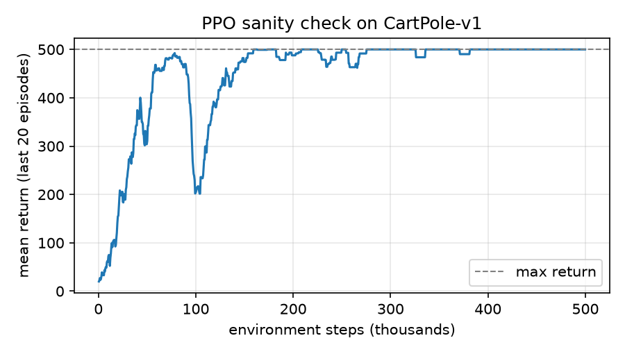
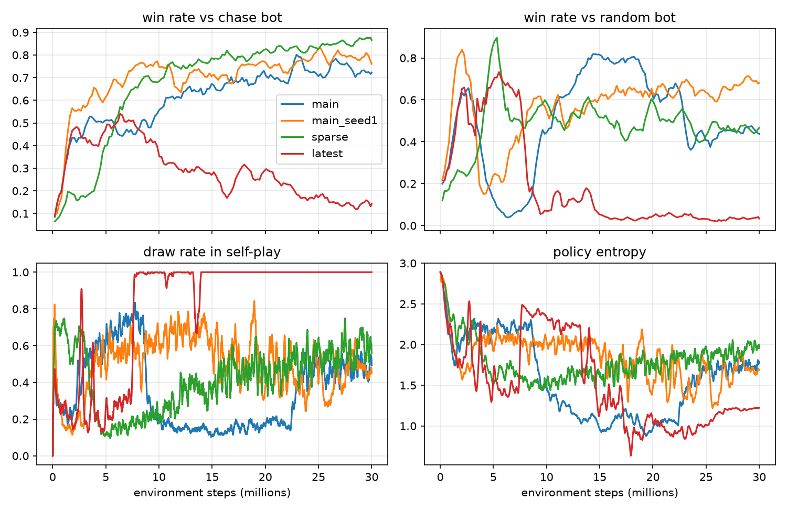
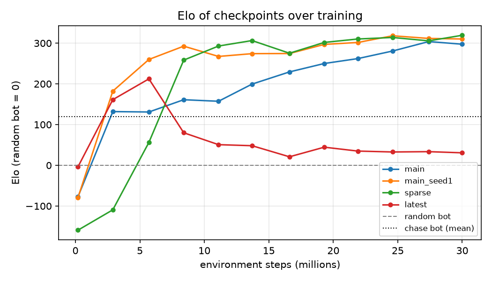
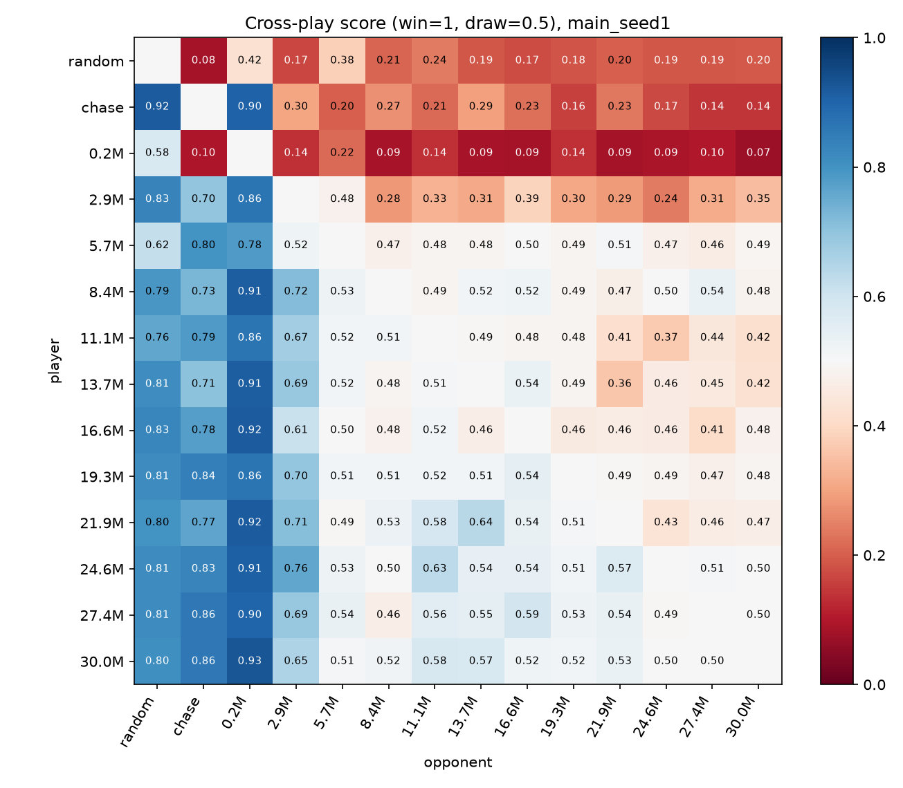
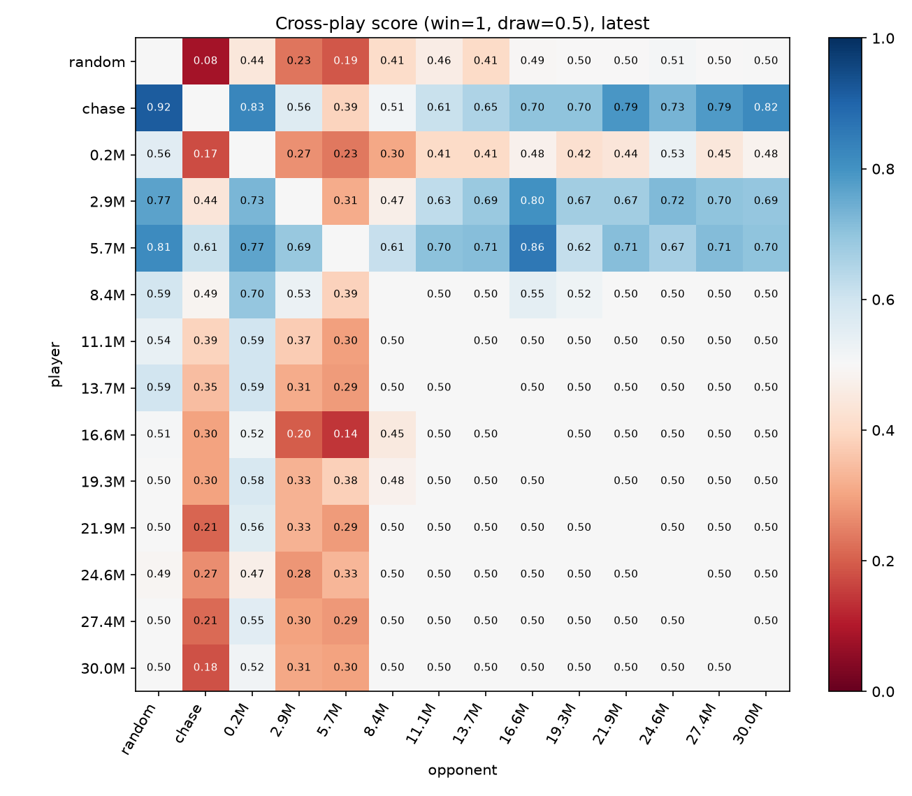
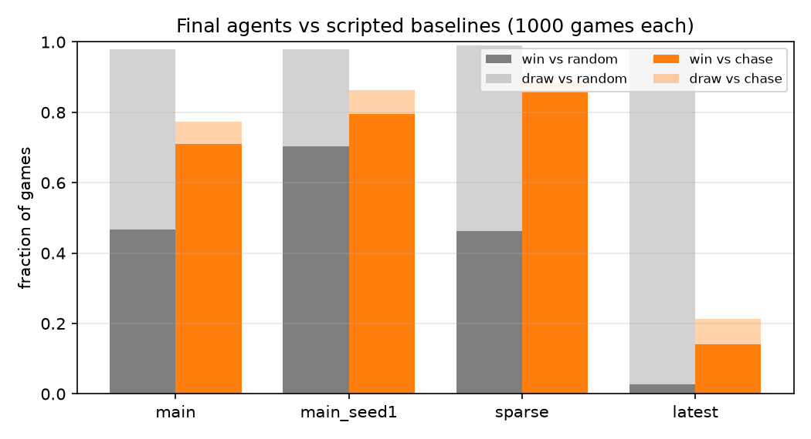
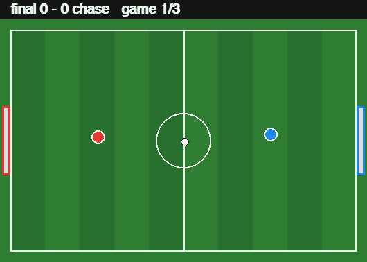
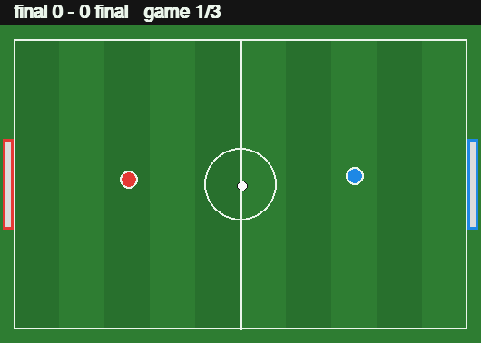
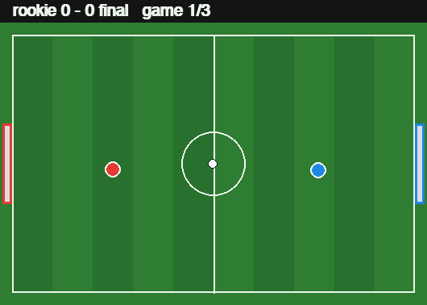
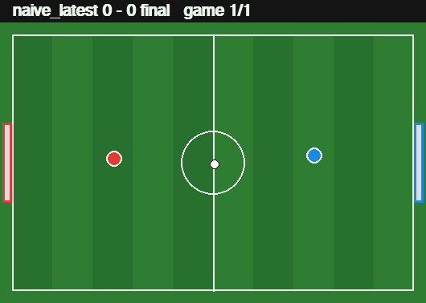

# Self-Play Deep RL for 2D Football

Utkarsh Upadhyay · CSE 4633 Artificial Intelligence · Midterm project (solo)

Live demo: <https://utkarsh-upadhyay9.github.io/selfplay-football/>

## 1. Question

Can self-play PPO, trained from scratch on a laptop CPU, produce 1v1 football
agents that keep getting better over training instead of just beating
whatever opponent they saw last? And does sampling opponents from a pool of
past checkpoints matter compared to playing only the latest copy?

**Short answer:** yes, with an opponent pool. Checkpoints from the pool runs
rise steadily to about +300 Elo over a random player, and later checkpoints
beat earlier ones in 83–89% of pairings. Naive "latest copy only" self-play
peaks early and then collapses into a passive strategy where 100% of its
self-play games end 0–0. That leaves it worse than the scripted baseline.

## 2. Environment

A top-down 1v1 game written from scratch in numpy (`football/core.py`) and
vectorized so that many games step at once (about 650k env-steps/s with random
actions).

- **Field:** 100 × 64 units, goals 20 units wide centered on each end. The ball
  bounces off walls (restitution 0.8) except inside the goal mouth.
- **Players:** discs of radius 2 with acceleration, damping and a top speed.
  They push the ball when they touch it (dribbling) and push each other apart.
- **Actions:** 18 discrete actions, made of 9 move options (stay or one of 8
  directions) times kick on or off. A kick sets the ball's velocity to 4.5
  units/step, pointing away from the player. It only works within reach and
  has an 8-step cooldown.
- **Observations:** 16 numbers, all ego-centric: own position and velocity,
  opponent position and velocity, ball position and velocity, the ball
  relative to self, kick cooldown, and time remaining. Team 1's view is
  mirrored along x, so every player "attacks to the right" and a single
  policy can play either side.
- **Episodes:** one goal ends the episode (+1 for the scorer, −1 for the
  other player). Otherwise it ends after 400 steps as a draw (0 reward).
- **Shaping (optional):** a potential-based term
  \(F = \Phi(s') - \Phi(s)\) with
  \(\Phi = -(d_{\text{ball→opp goal}} + 0.5\, d_{\text{self→ball}}) / 100\),
  multiplied by a coefficient that decays linearly from 1 to 0 over the first
  half of training.
- **Fairness:** the order in which the two players' ball contacts are
  resolved alternates every step. Before this fix, two identical scripted
  bots won 42% vs. 49% depending on side; after it they win 46.4% vs. 46.0%.
  Learned agents also play each side in half of all games.

A Gymnasium wrapper (`football/env.py`) and a pygame renderer
(`football/render.py`) are included. The browser demo uses a JavaScript port
of the physics (`docs/js/game.js`). A test steps both implementations with the
same actions and checks that they match to 1e-9.

## 3. Method

**PPO** (`football/ppo.py`): clipped objective (ε = 0.2), GAE
(γ = 0.995, λ = 0.95), 4 epochs × 4 minibatches per update, Adam with
lr 3e-4 annealed linearly to 0, gradient-norm clip 0.5, value coefficient
0.5, entropy coefficient 0.003. The actor and critic are separate 2×128 tanh
MLPs.

**Sanity check:** the same PPO code solves CartPole-v1 (mean return 500,
the maximum, after 500k steps).



**Self-play** (`football/selfplay.py`): 64 games in parallel, 128 steps per
rollout (8,192 samples per update), 30M environment steps per run. The
learner controls one player in every game. The 64 games are split into 8
blocks, and each block gets one frozen opponent per rollout:

- **pool** (default): with probability 0.5 the opponent is a frozen copy of
  the current learner, otherwise a snapshot sampled uniformly from all past
  snapshots (one is saved every 10 updates).
- **latest** (ablation): every block plays a frozen copy of the current
  learner.

Each 30M-step run took about 16 minutes on an Apple M5 MacBook Air, with four
runs training at the same time.

**Tuning note.** A first 10M-step probe with entropy coefficient 0.01
drifted back toward a near-uniform policy (entropy rose from about 2.1 to
2.6, where the maximum is ln 18 ≈ 2.89), and its self-play games settled
into roughly 70% draws. Three 15M-step variants were compared: entropy
coefficient 0.003, 0.001, and 0.003 plus a −0.5 reward for timeouts. 0.003
gave the best and most stable agent, so it is the default. The draw penalty
did not reduce draws and was not used further.

## 4. Runs

| run | reward | opponents | seed |
|---|---|---|---|
| `main` | shaped → sparse | pool | 0 |
| `main_seed1` | shaped → sparse | pool | 1 |
| `sparse` | sparse only | pool | 0 |
| `latest` | shaped → sparse | latest only | 0 |

The **final agent** used for the demo is `main_seed1`
(`models/final.pt`).

## 5. Results

### 5.1 Learning curves



Win rates against the bots are measured on 200 games every 25 updates.
Against the chase bot, all three pool runs climb to 70–87%. The latest-only
run peaks at about 50% near 5M steps and then falls to about 15%. Its
self-play draw rate locks at 100% from about 14M steps on.

### 5.2 Cross-play and Elo

Each run's checkpoints were evaluated in a round robin: 12 checkpoints
evenly spaced over training plus the random and chase bots, 200 games per
pair. The score counts a win as 1 and a draw as 0.5. Elo ratings are fit to
the full score matrix, with the random bot anchored at 0.



| run | final Elo | peak Elo | later checkpoint beats earlier one |
|---|---|---|---|
| main | 297 | 304 | 89% of pairs |
| main_seed1 | 310 | 318 | 85% |
| sparse | 319 | 319 | 83% |
| latest | 31 | 212 (at 5.7M) | 18% |

On this scale, the chase bot rates between 81 and 202 depending on the run.

Cross-play for the final agent's run (`main_seed1`):



Cross-play for the latest-only run. Its late checkpoints all draw with each
other and lose to its own early checkpoints:



The heatmap for `main` (`results/main/crossplay_heatmap.png`) shows the
expected structure, where rows below the diagonal are mostly blue. It also
shows one interesting effect: checkpoints from 24.6M steps onward draw almost
every game against checkpoints from 2.9M–8.4M, even though they beat
everything in between. Presumably those early opponents play defensively in a
way the later agents never learned to break down.

### 5.3 Baselines

Final agents, 1000 games against each bot, sides alternating:

| agent | vs random W / D / L | vs chase W / D / L |
|---|---|---|
| chase bot (reference) | 86.6 / 7.4 / 6.1 % | – |
| main | 46.8 / 51.2 / 2.0 % | 71.1 / 6.3 / 22.6 % |
| **main_seed1 (final)** | **70.3 / 27.7 / 2.0 %** | **79.6 / 6.7 / 13.7 %** |
| sparse | 46.2 / 52.8 / 1.0 % | 85.9 / 2.6 / 11.5 % |
| latest | 2.7 / 95.1 / 2.2 % | 14.0 / 7.4 / 78.6 % |



The learned agents almost never lose to the random player, but they often
fail to score against it within 400 steps. The random player jitters around
its kickoff spot, which happens to sit on the line between the ball and its
goal. Self-play opponents never behave like that, so this is a real
generalization gap rather than a bug.

### 5.4 Ablations

**Opponent pool vs. latest only.** This is the clearest result. With the
pool, Elo rises steadily. With latest-only self-play, the agent first
improves (Elo 212 at 5.7M steps), then the two copies drift into a
mutual-draw equilibrium where neither tries to score. Training never leaves
it, because a copy of the current policy never punishes passivity. The
collapsed agent largely stops playing the ball. Head-to-head, `main_seed1`
beats it in 86% of games. Interestingly, `main` and `sparse` cannot break it
down and draw every game.

**Shaped vs. sparse reward.** Shaping mostly speeds up the start. At 2.9M
steps the shaped runs are at +130 to +180 Elo and already beat the chase bot
45–60% of the time, while the sparse run is at −110 Elo and below 20%.
The sparse run catches up around 8M steps and ends level or slightly ahead
(Elo 319, 86% vs. chase). In this small environment, potential-based shaping
helps exploration early on but is not needed for final strength.

**Head-to-head between final agents** (score, row vs. column, 1000 games):

|  | main | main_seed1 | sparse | latest |
|---|---|---|---|---|
| main | – | 0.48 | 0.51 | 0.50 |
| main_seed1 | 0.52 | – | 0.55 | 0.91 |
| sparse | 0.49 | 0.45 | – | 0.50 |
| latest | 0.50 | 0.09 | 0.50 | – |

Most of these games are draws. Strong agents defend well against each other,
and scores of 0.45–0.55 mean they are about even.

### 5.5 Recorded matches

| | |
|---|---|
| Final agent (red) vs chase bot |  |
| Final agent vs itself |  |
| Rookie (0.8M steps, red) vs final agent |  |
| Collapsed latest-only agent (red) vs final agent |  |

## 6. Limitations and next steps

- **Seed variance.** Two seeds of the same configuration differ noticeably:
  70% vs. 47% wins against the random player. A proper comparison would use
  3–5 seeds per configuration.
- **Draw-heavy equilibria.** Between strong agents most games end 0–0, and
  agents can fail to exploit opponent styles they never trained against
  (the random player, the passive collapsed agent). Ideas to try: a larger
  pool sampled by win rate (as in prioritized fictitious self-play), or
  adding scripted bots to the pool.
- **2v2 with parameter sharing** (the stretch goal) was not attempted.

## 7. Reproducing

```bash
pip install -r requirements.txt
python -m pytest -q                       # physics, PPO and JS-parity tests
python scripts/sanity_cartpole.py         # PPO sanity check
python scripts/train.py --name main --seed 0
python scripts/train.py --name main_seed1 --seed 1
python scripts/train.py --name sparse --sparse
python scripts/train.py --name latest --opponents latest
python scripts/plot_curves.py runs/main runs/main_seed1 runs/sparse runs/latest
for r in main main_seed1 sparse latest; do python scripts/crossplay.py runs/$r; done
python scripts/plot_elo_compare.py results/main results/main_seed1 results/sparse results/latest
python scripts/ablations.py runs/main runs/main_seed1 runs/sparse runs/latest --games 1000
python scripts/play.py --agent models/final.pt
```
